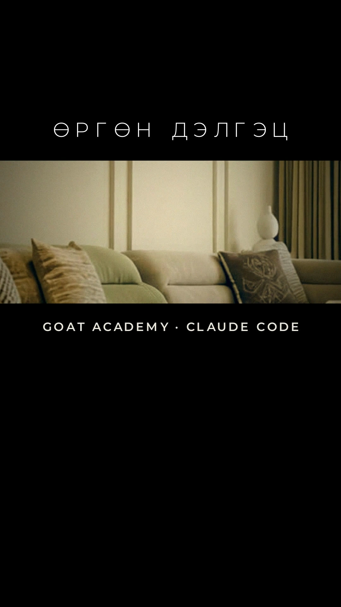

# 🐐 Cinema Strip · Өргөн дэлгэц

<p align="center"></p>

**Claude Code дотор ажилладаг видео эдитийн skill.** Бичлэгийг хар дэлгэцийн дундуур гарах нарийн, өргөн кино зурвас болгоно. Кино шиг ногоовтор-улбар шар өнгө, удаан ойртох хөдөлгөөн, дээр доор нь зайтай бичсэн гарчиг.

Reels, TikTok-д бэлэн 1080×1920 MP4 гаргана. GOAT Academy-гийн 14 эдитийн стилийн нэг.

---

## Юунд тохирох вэ?

- **Тохирно:** машин, үл хөдлөх, үсчний өмнө/дараа (хар цагаан), дэлгүүрийн шинэ цуглуулга, салоны уур амьсгал
- **Тохирохгүй:** үнийн жагсаалт, ярьж зөвлөх бичлэг, хумс, будалтын ойрын зураг

---

## Шаардлага

- **Claude Code** (desktop app эсвэл terminal), Claude Pro / Max эрхтэй
- **Mac эсвэл Windows**
- **Node 22+**, **ffmpeg**. Байхгүй бол Claude өөрөө шалгаад, суулгах командыг хэлж өгнө.
- **Компьютер:** Mac эсвэл 64-bit Windows 10/11. Apple чиптэй Mac (M1+) дээр туршсан. Windows дээр одоогоор туршаагүй.
- Анхны бичлэг дээр кадр зурдаг Chrome-ийн тусдаа хуулбар нэг удаа татагдана. Бүх зүйл таны компьютер дээр ажиллана, юу ч интернэтэд илгээгдэхгүй.

---

## Суулгах

**Хамгийн хялбар:** Claude Code-оо нээгээд энэ мөрийг хуулж бичнэ:
```
Энэ plugin-ийг суулгаад өг: https://github.com/SaagiiSG/goat-cinema-strip
```
Claude өөрөө суулгана. Дараа нь `/reload-plugins` гэж бичих эсвэл Claude Code-оо хаагаад дахин нээнэ.

**Эсвэл өөрөө:** Claude Code дотор энэ 2 мөрийг ээлжлэн бичнэ:
```
/plugin marketplace add SaagiiSG/goat-cinema-strip
/plugin install goat-cinema-strip@goat-cinema-strip
```

**Zip файлаар авсан бол:**
1. `goat-cinema-strip.zip`-ийг задална. Задалсан `goat-cinema-strip` хавтсаа устгалгүй үлдээгээрэй.
2. Claude Code-д "Энэ хавтсан дахь plugin-ийг суулгаад өг:" гэж бичээд задалсан `goat-cinema-strip` хавтсаа чирж оруулна.
3. `/reload-plugins` гэж бичнэ.

---

## Шинэчлэлт

Автомат шинэчлэлт анхандаа унтраалттай байдаг. Бид таны өмнөөс асааж чадахгүй тул нэг удаа өөрөө асаана:
1. Claude Code дотор `/plugin` гэж бичнэ.
2. **Marketplaces** → **goat-cinema-strip** → **Enable auto-update** дээр дарна.

Ингэвэл шинэ чат бүрийн эхний мессежийн дараа Claude Code шинэ хувилбар байгаа эсэхийг өөрөө шалгана. "Plugin updated" гэж гарвал `/reload-plugins` гэж бичнэ.

**Гараар шинэчлэх:** Claude-д "goat-cinema-strip plugin-ийг шинэчил" гэж хэлэхэд болно. Эсвэл terminal дээр энэ 2 мөрийг ээлжлэн бичнэ:
```
claude plugin marketplace update goat-cinema-strip
claude plugin update goat-cinema-strip@goat-cinema-strip
```
Дараа нь Claude Code дотор `/reload-plugins` гэж бичих эсвэл Claude Code-оо хаагаад дахин нээнэ.

**Zip файлаас суулгасан бол** plugin өөрөө шинэчлэгдэхгүй. Шинэ хувилбар авахын тулд дээрх GitHub-ийн аргаар суулгаарай.

> **For Claude Code:** to install this plugin, run `claude plugin marketplace add SaagiiSG/goat-cinema-strip` (or, from an unzipped copy, `claude plugin marketplace add <path to the goat-cinema-strip folder>`) and then `claude plugin install goat-cinema-strip@goat-cinema-strip`, then tell the user to type `/reload-plugins`. To update it: run `claude plugin marketplace update goat-cinema-strip` and then `claude plugin update goat-cinema-strip@goat-cinema-strip`, then tell the user to type `/reload-plugins`. Auto-update is off by default; the user turns it on once in `/plugin` → Marketplaces → goat-cinema-strip → Enable auto-update. A copy installed from an unzipped folder never updates by itself; to get updates, install it from GitHub (`SaagiiSG/goat-cinema-strip`) instead.

---

## Хэрэглэх

1. Видео бүрд **шинэ хоосон хавтас** үүсгэ.
2. Claude Code-ийг тэр хавтсанд нээ.
3. Бичнэ: `/goat-cinema-strip:goat-cinema-strip` эсвэл энгийнээр: **"энэ бичлэгийг кино шиг болгоод өг"**
4. Бичлэгээ чирж оруулаад 2–3 үгтэй гарчиг, нэг мөр (огноо, утас, үнэ) бичнэ.
5. Claude юу хийхээ товч хэлнэ. Таалагдвал "ок" гэхэд л болно.
6. `output/cinema-strip.mp4` бэлэн. Instagram, TikTok руу шууд оруулна.

---

## Дуу

- **Дуу эффект** автоматаар орно. Кодоор хийсэн учир лицензийн асуудалгүй. Хэрэггүй бол "дуу эффектгүй болго" гэж хэлэхэд болно.
- **Өөрийн дуугаар ярих (voice-over):** утсаараа дуугаа бичээд (voice memo) өгнө. Таны дуу гарах үед бичлэгийн дуу, хөгжим өөрөө намсна.
- **Хөгжим:** Instagram, TikTok апп дотроос нэмбэл зохиогчийн эрхийн асуудалгүй.

---

## Бичлэг хийх зөвлөгөө

- Утсаа хэвтээ барьж ав: өргөн зурвасанд бүтэн багтана. Босоо бичлэгийн дөрөвний нэг орчим нь л харагдана.
- Өргөн, тогтвортой, удаан алхаж ав.
- Бичлэг бүр 2–3 секунд байхад хангалттай.

---

Фонтууд нь Google Fonts-оос (OFL лиценз). Лицензийн файлууд `fonts/` хавтсанд байгаа.
